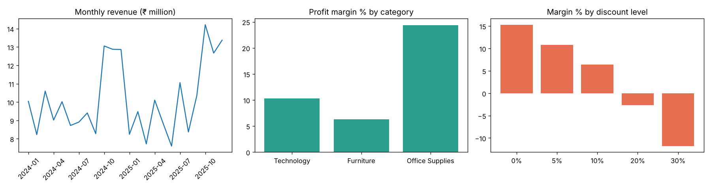

# Retail Sales Analytics: Python + SQL + Power BI

End-to-end analysis of retail orders: clean the data in Python, load it into a SQL database, answer business questions with SQL, and prepare the data and DAX measures for a Power BI dashboard.

> **Data note:** the dataset is **synthetic**, generated by `generate_data.py` (seeded, reproducible) with deliberate problems: duplicate orders, mixed-case regions, missing values, and two date formats. The figures below describe this generated data, not a real company.

## Pipeline
1. `generate_data.py` creates `data/raw_orders.csv` (9,765 rows).
2. `clean_and_load.py` removes duplicate order IDs (144), standardises regions and dates, fills missing cities, drops rows with no sales value (81), and loads 9,540 clean rows into `retail.db`.
3. `sql/queries.sql` holds 9 queries (aggregations, CTEs, window functions, a year-over-year self-join). `run_analysis.py` runs them and exports CSVs to `powerbi/`.
4. `powerbi/dax_measures.md` has the DAX measures and report layout for the dashboard.

Run: `pip install pandas matplotlib && python generate_data.py && python clean_and_load.py && python run_analysis.py`

## What the data shows
- **Discounts are the margin problem.** Margin falls from 15.3% at no discount to -2.7% at 20% off and -11.8% at 30% off. Orders at 20% or more make up about 20% of all orders.
- **Revenue is concentrated.** The top 20% of customers produce 68% of revenue.
- **Seasonality.** Revenue jumps in October to December each year (about 13M vs 9M in a typical month).
- **Category mix.** Technology brings about 78% of revenue at a 10.3% margin; Furniture has the weakest margin at 6.3%.
- **Recommendation:** cap discounts at 10% on Technology and Furniture and test targeted offers for the top customer group instead of blanket discounts.

## Tools
Python (Pandas, Matplotlib), SQL (SQLite; queries are standard SQL and run on MySQL with minor changes), Power BI / DAX.
